<div align="center">


### `> Developer | Web Development | Code & Create`

[](https://github.com/Beglgamer)
[](https://github.com/Beglgamer)

</div>

---

## `> about_me.exe`

```bash
┌──(Beglgamer㉿github)-[~]
└─$ cat about_me.txt

Hey! I'm Beglgamer 👋
I enjoy coding, building projects and learning new technologies.
Currently exploring web development and software development.

┌──(Beglgamer㉿github)-[~]
└─$ _
```

- 🌐 Interested in **Web Development**
- 💻 Building with **HTML, CSS, JavaScript and Python**
- 🚀 Exploring **Java and Swift**
- ⚡ Always learning, experimenting and creating

## `> tech_stack --list`

<div align="center">

### Languages & Web


### Tools


</div>

## `> github_stats --show`

<div align="center">

<!-- These SVGs are generated by GitHub Actions and stored in this repository. -->
<picture>
  <source media="(prefers-color-scheme: dark)" srcset="./assets/overview.dark.svg" />
  
</picture>

<picture>
  <source media="(prefers-color-scheme: dark)" srcset="./assets/languages.dark.svg" />
  
</picture>

</div>

## `> activity.log`

<div align="center">

<picture>
  <source media="(prefers-color-scheme: dark)" srcset="./assets/rhythm.dark.svg" />
  
</picture>

<picture>
  <source media="(prefers-color-scheme: dark)" srcset="./assets/contributions.dark.svg" />
  
</picture>

</div>

## `> contribution_snake --run`

<div align="center">

<picture>
  <source media="(prefers-color-scheme: dark)" srcset="https://raw.githubusercontent.com/Beglgamer/Beglgamer/output/github-contribution-grid-snake-dark.svg" />
  <source media="(prefers-color-scheme: light)" srcset="https://raw.githubusercontent.com/Beglgamer/Beglgamer/output/github-contribution-grid-snake.svg" />
  
</picture>

</div>

---

<div align="center">

```bash
$ echo "Thanks for visiting my profile!"
> Keep coding. Keep creating. Stay curious. ⚡
```


</div>
